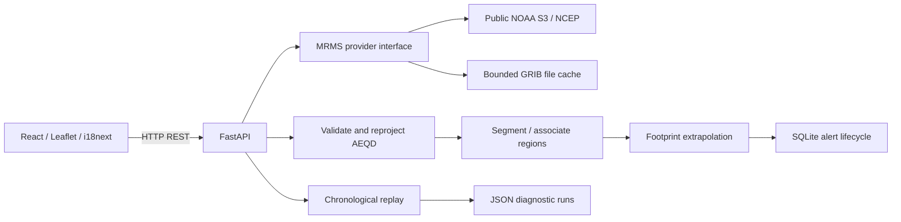

# Architecture

One local Python process and a browser application. There are no accounts, background cloud workers, paid APIs or distributed services.

## Boundaries

`models.py` is the Pydantic request/result contract. `radar.py` owns validated numeric observations and spatial transforms; no UI palette is used to infer radar values. `providers.py` owns anonymous catalog discovery, transfer, decompression, time validation and disk cleanup behind `RadarProvider`. No random radar source is selected from user-controlled URLs.

`tracking.py` owns component identity/motion and conservative ambiguity handling. `nowcasting.py` converts accepted motion plus footprint geometry into experimental attention levels. `history.py` owns a SQLite lifecycle scoped to the complete watched location/radius/threshold. It records created/updated/cancelled/suspended changes and retains at most 2000 records. The server preserves track identities between refreshes when overlapping observations exist; a gap or process restart may start new tracks.

`replay.py` forecasts each prefix of a bounded observation sequence and performs future verification only afterward. `main.py` assembles synchronous CPU/I/O operations as FastAPI worker-thread endpoints, serializing shared provider/analysis work to avoid duplicate downloads on a personal machine. This favors simplicity over multi-user throughput.

The frontend uses matching TypeScript interfaces in `frontend/src/services/api.ts`. Old-location data are cleared; live estimates are shown only with the latest matching observation. Browser requests are cancelled when location/mode changes. Cancelling a browser request does not interrupt an already running synchronous server download; stopping monitoring prevents subsequent polls.

## REST API

| Endpoint | Purpose |
| --- | --- |
| `GET /api/health` | Local process/version check; not a claim that NOAA is available |
| `GET /api/analysis` | Combined coverage, actual frames and latest predictions |
| `GET /api/coverage` | Product-mask and optional RQI coverage at a point/circle |
| `GET /api/radar/latest`, `/api/radar/frames` | Geographic PNG overlays with source/time |
| `GET /api/precipitation`, `/api/predictions`, `/api/alerts` | Same current region summaries and experimental levels |
| `GET /api/history` | Alert changes for the exact watch configuration |
| `GET /api/search` | Cached submitted city/place search |
| `GET /api/sample` | Bundled real observation provenance/geometry |
| `POST /api/replay` | Bounded archive or bundled episode replay and metrics |
| `GET /api/runs` | Up to 50 locally saved run summaries |

Location query parameters: WGS84 lat/lon, radius 10–100 km, threshold 0.1–10 estimated mm/h. Replay adds timezone-aware start/end and optional `sample`. OpenAPI documents the concrete schema at `/docs`. Pydantic rejects invalid inputs before download. Provider failures produce explicit unavailable states and no replacement observations. A replay with too few actual observations returns a structured error.

## Storage and bounds

- LocalStorage: language, watched coordinates/radius/threshold and enabled alert levels. Audio still requires a user gesture each session.
- `.cache/grib`: up to 80 packed GRIB files, 300 MB cumulative budget and 24-hour inactive age. File selection updates recency. Catalog TTL 60 s; eight watch results and tracking states are retained in memory.
- `.cache/history.sqlite3`: local coordinates and alert payloads. No external database.
- `.cache/runs`: at most 50 metric summary JSON files. Full replay output can be exported by the user.
- Each HTTP download is size-bounded; gzip inflation is capped at 64 MB packed GRIB. Decompression is not equivalent to full scientific-grid decoding: GDAL can still use hundreds of MB internally.
- A local rate grid has at most 241×241 cells (100 km radius +20 km processing margin). Up to 100 largest regions are tracked. Live downloads at most six time steps; replay at most 18. Rate, low-altitude reflectivity, RQI and display-only QC composite can require up to four products per step.

The address adapter has an independent client/lock, so autocomplete does not wait behind radar downloads. Photon is enabled by default under the user’s authorization; the client supplies `external=true`. Suggestions use location bias rounded in the browser, request cancellation and debounce; the backend limits upstream calls to one per second, with bounded five-minute RAM cache. It writes no address query files. Live-watch preferences remain exclusively LocalStorage; replay coordinates are temporary. SQLite alert history is still local to this computer and is not a remote saved-watch service.

## Observed resource snapshot

Windows 11, Python 3.12.14, no GPU: an actual 50 km Mexicali analysis loaded six current NOAA time steps with auxiliary quality/reflectivity in 19.8 s server time (20.0 s HTTP wall time). The server working set was approximately 114.5 MiB after processing, with a 393.7 MiB peak; its initial working set was approximately 91 MiB. These are one-machine measurements, not requirements or a speed guarantee. The bundled 11-frame replay evaluation took approximately 2–3 s locally. Final browser assets are about 401 kB JavaScript / 124 kB gzip, plus roughly 31 kB CSS before compression. Public tile/network costs are additional.

History is retained locally until manually removed with the app stopped; it is intentionally ignored by Git. No analytics, accounts or public deployment are implemented. Opt-in background Web Push keeps its key, subscription and watched point locally; encrypted payloads pass through browser push services. The loopback binding is the intended operating mode; the app has no authentication for public hosting.
